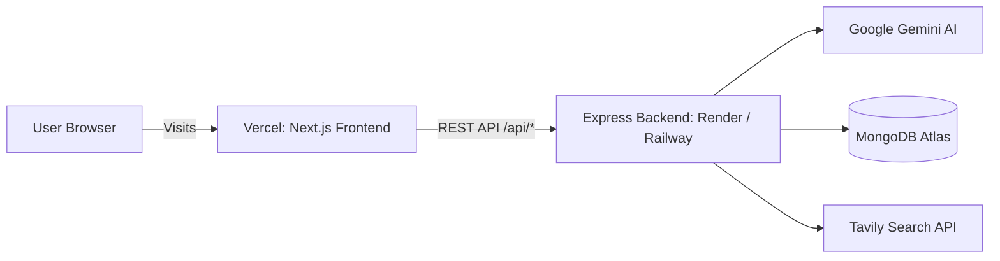

# 🚀 Deploying to Vercel

This project is fully configured and ready for 1-click deployment to **Vercel**.

---

## ⚡ Quick Deployment Steps (Recommended)

### Step 1: Push your code to GitHub
Ensure all your latest changes are pushed to your GitHub repository:
```bash
git add .
git commit -m "feat: configure vercel deployment"
git push origin main
```

### Step 2: Import into Vercel
1. Go to [vercel.com/new](https://vercel.com/new) and log in.
2. Select your repository: **`Fake_Job_Detatction`**.
3. In **Project Settings**:
   - **Framework Preset**: `Next.js`
   - **Root Directory**: Leave as `./` (or select `client` — both are supported!)

### Step 3: Configure Environment Variables
Under **Environment Variables**, add the following:

| Variable | Recommended Value | Description |
| :--- | :--- | :--- |
| `NEXT_PUBLIC_API_URL` | `https://your-backend-api.onrender.com/api` | Your deployed Express backend API URL |
| *(Optional)* `BACKEND_URL` | `https://your-backend-api.onrender.com` | If set, Next.js rewrites `/api/*` requests directly through the domain (eliminating CORS) |

> 💡 **Note:** `GEMINI_API_KEY`, `MONGODB_URI`, and `TAVILY_API_KEY` belong strictly to your **backend server** (on Render, Railway, or Fly.io) and should **never** be added to the frontend Next.js client.

### Step 4: Click Deploy!
Vercel will automatically build the Next.js application and deploy it globally on the Vercel Edge Network.

---

## 🌐 Fullstack Architecture Guide



### Backend Hosting Options (Free / Low Cost)
Because the backend uses persistent Express server listeners and MongoDB connections, host the `server/` directory on:
1. **[Render](https://render.com/)**: Free Web Service running `node src/server.js` from the `server` root directory.
2. **[Railway](https://railway.app/)**: 1-click Node.js deployment.
3. **[Fly.io](https://fly.io/)**: Fast global container deployment.

Make sure your backend service has `CLIENT_URL` set to your Vercel deployment URL (e.g. `https://your-project.vercel.app`). The server's CORS configuration already automatically allows all `*.vercel.app` domains.
